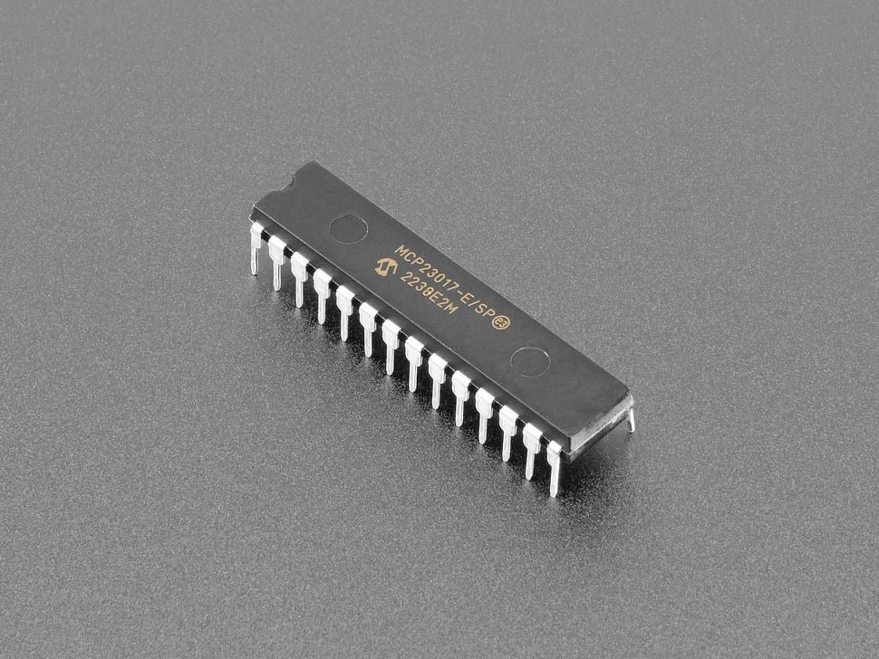

<p align="center">
  
  <br><sub>Adafruit MCP23017 breakout &mdash; photo <a href="https://www.adafruit.com/product/732">Adafruit Industries</a></sub>
</p>

# mcu-expander

<p align="center">
  
  
  
</p>

A small C GPIO expander library for **ESP-IDF 5.2+** and **STM32 HAL**. The
Microchip MCP23017 (I2C) and its SPI twin, the MCP23S17, keep one handle
API and hand out a `struct expander_dev`: pin modes with pull-ups, single
pins or the whole port in one transaction, and interrupts on change with an
ISR-safe hook for the INT line. This library replaces `esp-mcp23-expander`;
the MCP23S17 and the STM32 port are new.

The repository is named `mcu-expander`; the C API, `CONFIG_EXPANDER_*`
options and forge package key are `expander`. The clone command below names
the ESP-IDF component directory `expander` as well.

> **Hardware unverified.** Host tests use simulated chips and platform stubs.
> Nothing here has run on a physical chip.

[Supported hardware](#supported-hardware) · [Install](#install) ·
[Quick start](#quick-start) · [Examples](#examples) ·
[Documentation](#documentation) · [Tests](#tests)

## Supported hardware

| Chip | Interface | Notes |
|---|---|---|
| **MCP23017** | I2C, 0x20–0x27 | 16 pins, 100 kΩ pull-ups, INTA/INTB; **GPA7 and GPB7 are output only** (data sheet Rev D and later) |
| **MCP23S17** | SPI mode 0, up to 10 MHz, A2..A0 shared chip select | the same 16 pins and registers, no output-only pins |

Both are one Kconfig option, `EXPANDER_MCP23`. Wiring is in the
[wiring guide](docs/hardware.md).

## Install

### ESP-IDF

Clone into your project's components directory:

```sh
git clone https://github.com/JonasAtelier/mcu-expander components/expander
```

Enable the chip in `idf.py menuconfig` → **Component config → GPIO expander
subsystem**, or add this to `sdkconfig.defaults`:

```ini
CONFIG_EXPANDER=y
CONFIG_EXPANDER_MCP23=y
```

The `main` component sees the library automatically. Other components declare
`REQUIRES expander driver` in `idf_component_register()`.

### esp-forge / stm-forge

stm-forge must be at `ee921c3` or later, which builds the chip folders in
`src/`; older ones fail at link with undefined chip functions.

Add to `profiles/pkgversion`:

```make
expander_GIT=https://github.com/JonasAtelier/mcu-expander@stable
```

Enable the package and the chip in `configs/<target>_defconfig`:

```make
PKG_expander        = y
EXPANDER_MCP23      = y
```

### STM32 HAL without forge

Compile every `.c` under `src/`, chip folders included, add `include/` and
`src/` to the include path, and define `CMSIS_device_header` as your family
header, `USE_HAL_DRIVER`, and `CONFIG_EXPANDER_MCP23=1`. The MCP23017 needs
the HAL I2C module, the MCP23S17 the SPI module.

**No chip driver is enabled by default.** See the
[installation guide](docs/installation.md) for all options.

## Quick start

On ESP-IDF, with an `i2c_master` bus created, exactly as esp-mcp23-expander:

```c
#include "mcp23.h"

mcp23_handle_t io;
ESP_ERROR_CHECK(mcp23_init(bus, NULL, &io));    /* NULL = address 0x20 */

mcp23_set_mode(io, 0, MCP23_OUTPUT);            /* GPA0 drives an LED */
mcp23_set_mode(io, 8, MCP23_INPUT_PULLUP);      /* GPB0 reads a button */

mcp23_write(io, 0, true);

bool pressed;
mcp23_read(io, 8, &pressed);
pressed = !pressed;                             /* buttons pull to ground */
```

- `mcp23_expander(io)` is the same chip as a `struct expander_dev`:
  `expander_set_mode()`, `expander_write()`, `expander_write_port()` with a
  mask, `expander_read_interrupt()`, and `expander_irq()` for the INT line's
  ISR. See [API usage](docs/usage.md).
- The MCP23S17 starts with `mcp23s17_init()`; every other call is the same.
- On ESP-IDF the chip calls return `esp_err_t`, as esp-mcp23-expander did;
  on the HAL, **0 or a negative errno**. `expander_*` is errno on both.

## Examples

| Chip | ESP-IDF | STM32 HAL |
|---|---|---|
| MCP23017 | [mcp23017](examples/esp/mcp23017/) (esp-mcp23-expander's) | [mcp23017](examples/stm/mcp23017/main.c) |
| MCP23S17 | [mcp23s17](examples/esp/mcp23s17/) | [mcp23s17](examples/stm/mcp23s17/main.c) |

ESP-IDF examples locate this library through `EXTRA_COMPONENT_DIRS`, which
assumes the repository is checked out as `expander`. With ESP-IDF activated:

```sh
cd examples/esp/mcp23017
idf.py set-target esp32 # Replace with your board's target.
idf.py build
```

STM32 examples are snippets to integrate into your application.

## Scope and limitations

- **Interrupts fire on any change.** `DEFVAL`/`INTCON` compare-to-value
  interrupts are not offered; init clears both.
- **The power-on register layout** (`IOCON.BANK = 0`) only; init puts a chip
  left in the other one back.
- **No locks.** One thread per device, or your own mutex; the bus's own
  driver serialises transfers.
- **RESET is not driven.** Tie it to VDD.

## Documentation

| Guide | Contents |
|---|---|
| [Installation](docs/installation.md) | Forge, ESP-IDF, STM32 HAL, build options and logging setup |
| [Hardware](docs/hardware.md) | Pins and wiring, pin numbering, electrical limits |
| [API usage](docs/usage.md) | The handle and the category view, ports, interrupts and the INT hook, errors, changes from esp-mcp23-expander |
| [Chip reference](docs/chips.md) | Registers, start-up, the output-only pins, the MCP23S17 and HAEN, interrupt behaviour |
| [Development](docs/development.md) | Platform ports, bus abstraction, adding a driver and test coverage |

## Tests

```sh
make -C test test
```

Host-only tests use stubbed HAL and ESP-IDF APIs; no embedded toolchain or
physical chip is needed. See the [test reference](docs/development.md#tests).
Error logs during the suite are expected: tests deliberately exercise
failure paths.

## License

[MIT](LICENSE)
